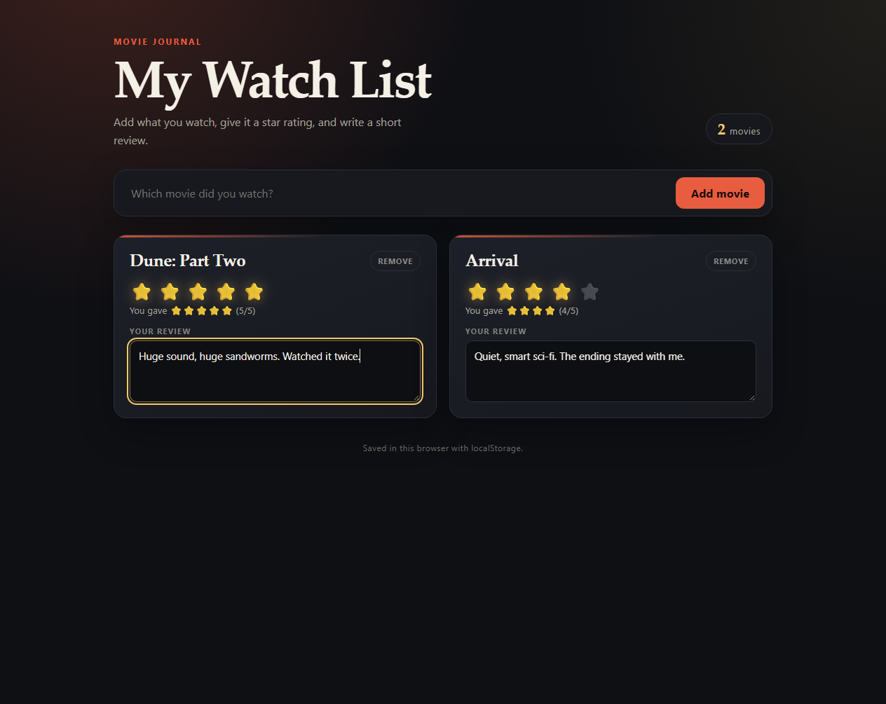
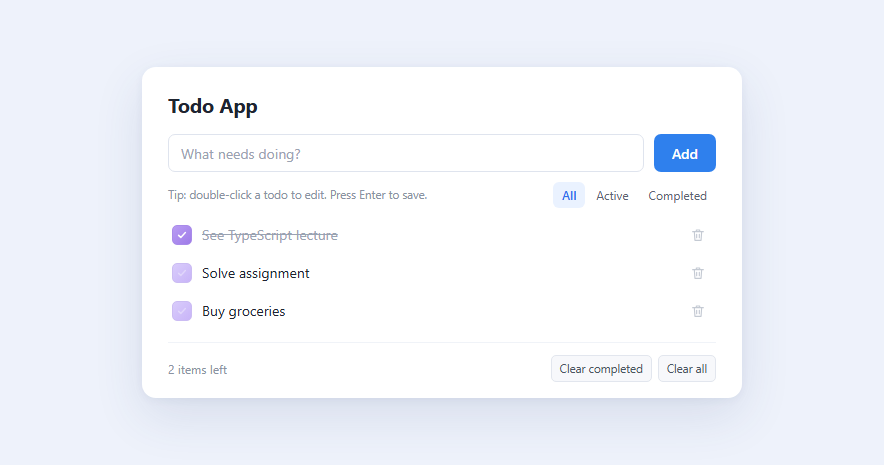

# Web Dev Labs — Report

**Public GitHub repository:** <https://github.com/Adham7843/webdev-reddit-clone>

Both labs are deployed in this public repository.

| Lab | Project | Tech | Code |
| --- | --- | --- | --- |
| 3 | Movies Watch List | React + Vite + CSS | [Lab 3 folder](https://github.com/Adham7843/webdev-reddit-clone/tree/main/work/drills/03-movies-watchlist) |
| 4 | Todo App | TypeScript + DOM + Vite + CSS (no React) | [Lab 4 folder](https://github.com/Adham7843/webdev-reddit-clone/tree/main/work/drills/04-todo-typescript) |

## Lab 3 — Movies Watch List

Save movies you watched, rate them, and write a short review.

- Add and remove movies
- 1–5 star rating
- Review textarea saved with the movie
- Rating shown with emojis, e.g. `You gave ⭐⭐⭐⭐ (4/5)`
- Movies persist in the browser with `localStorage`

## Lab 4 — Todo App (TypeScript, no React)

A plain TypeScript todo app. The page shell is HTML; the state, rendering, and
events are in `src/main.ts`.

- Add, toggle, and delete todos
- Double-click to edit — Enter saves, Escape cancels
- All / Active / Completed filters
- “Items left” counter
- Clear completed / Clear all
- Types: `Todo`, `Filter`, `Todo[]`, `string | null`, a `value is Filter` type
  guard, a generic `getElement<T>`, and strict mode

## Notes

The screenshots above live in [`screenshots/`](screenshots/). Replace
`lab-3-movies-watchlist.png` and `lab-4-todo-app.png` with your own captures
using the same filenames, or update the links in this file.

Each lab has its own `README.md` with run instructions and a breakdown of the
code.
